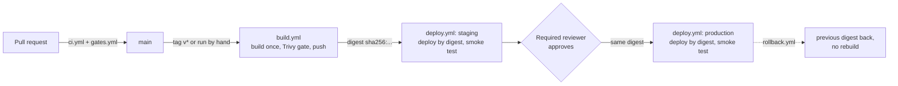

# GitHub Actions safe deploys: build once, approve, promote, roll back

[](https://github.com/tales-andre/github-actions-safe-deploys/actions/workflows/ci.yml)
[](https://github.com/tales-andre/github-actions-safe-deploys/actions/workflows/gates.yml)

**A common request on freelance job boards:** a small startup deploys by hand from someone's laptop, and the
cloud access key that makes it possible sits in the repository's GitHub secrets. They want every pull request
tested, the exact image that passed the tests to be the one that reaches production, a person to approve each
production release, and a quick way back when a release goes wrong.

This repository is an **open-source demo** of how I set that up, for **Kettlebird, a fictional startup**. It is not
a client project. Everything runs on GitHub's own runners and on your machine, with no cloud account. The AWS and
Google Cloud parts are written and tested offline, but have never run against a live account (see [Limits](#limits)).

## What this shows

- **Every pull request is checked.** Unit tests, an image build with a vulnerability scan, two workflow linters
  (actionlint and zizmor) and the Terraform tests run on every pull request. The token is read-only and the
  workflows use no secrets, so a pull request from a fork can run all of it and has nothing to steal. They use
  `pull_request`, never `pull_request_target`.
- **Each job gets only the permissions it needs, and nothing can change under the pipeline.** Every workflow
  starts from `permissions: {}`. Every external action is pinned to a full commit SHA, with its release in a
  comment, and every tool image is pinned by digest. `scripts/check-pins.sh` fails CI if one is not.
- **The image is built once and promoted by its digest.** `build.yml` builds, scans and pushes one image and
  returns its digest (`sha256:...`). Staging and production both deploy `name@sha256:...`; nothing is rebuilt for
  production. `deploy.sh` refuses a plain tag, and the smoke test checks that every ready pod runs that digest.
- **Trivy blocks a vulnerable image.** Any CRITICAL or HIGH vulnerability with a fix available stops the job
  before the push.
- **Production waits for a person.** It is a GitHub environment with a required reviewer. The release refuses to
  start the production step if that rule is missing. A `concurrency` lock per environment keeps two deploys
  from overlapping.
- **A broken release never takes over, and rollback is one step.** Old pods keep serving until new ones are ready.
  If they never become ready, `deploy.sh` rolls back by itself. `rollback.yml` puts back the digest the
  environment ran before its last deploy, without a rebuild.
- **Cloud login without stored keys.** The deploy job logs in to AWS with GitHub's OIDC token and to Google
  Cloud with Workload Identity Federation. Both steps run only when the repository variables exist; without them
  they are skipped. The Terraform in `infra/` creates the matching AWS role and Google pool, each trusting only
  `repo:<owner>/<name>:environment:<env>`.
- **The safety checks are tested too.** `gates.yml` runs three negative tests, and each one passes only if the bad
  thing it tries is stopped, for the expected reason:
  1. a known-vulnerable image is blocked by Trivy;
  2. a release that crashes at start is rolled back while production keeps serving, and the rollback path puts
     the previous digest back;
  3. a deliberately unsafe workflow ([`examples/unsafe/`](examples/unsafe/)) is rejected by actionlint, zizmor and
     the static key check.

## Run it yourself

You need Docker, bash (Git Bash works on Windows), kubectl, Node.js 22 and Terraform 1.7 or newer. You do not need
a cloud account or any credentials.

```bash
# App tests (no dependencies to install)
(cd app && npm test)

# Image: the tests run again inside the build; then the same Trivy gate as CI
docker build -t kettlebird-hello:local app
scripts/scan-image.sh kettlebird-hello:local

# Throwaway Kubernetes cluster with a local registry, then the broken-release and rollback test
scripts/install-kind.sh                 # pinned kind release, checksum verified
scripts/kind-up.sh --local-registry
scripts/gate-broken-release.sh
scripts/kind-down.sh

# Workflow checks, including the unsafe example that must be rejected
scripts/check-pins.sh
scripts/lint-workflows.sh
scripts/gate-unsafe-example.sh

# Terraform, offline: mocked providers, nothing is created
terraform -chdir=infra init -backend=false
terraform -chdir=infra test
scripts/check-no-static-keys.sh
```

The scripts keep their own kubeconfig in `.kind/kubeconfig` and never read or change yours.

## What CI checks

| Workflow | When | What it does |
|---|---|---|
| [`ci.yml`](.github/workflows/ci.yml) | every pull request and push to `main` | app tests; image build and Trivy scan (no push); actionlint, zizmor and pin check; `terraform fmt`, `validate` and `test`; static key check |
| [`gates.yml`](.github/workflows/gates.yml) | every pull request and push to `main` | the three negative tests above, each green only when the bad thing is stopped |
| [`release.yml`](.github/workflows/release.yml) | a `v*` tag, or by hand | build once, staging, approval, production, all with the same digest |
| [`rollback.yml`](.github/workflows/rollback.yml) | by hand | puts back the previous digest (or one you paste in) |
| [`build.yml`](.github/workflows/build.yml), [`deploy.yml`](.github/workflows/deploy.yml) | called by the others | the reusable parts: build/scan/push, and deploy one digest into one environment |

Latest green runs on `main`: [ci](https://github.com/tales-andre/github-actions-safe-deploys/actions/workflows/ci.yml?query=branch%3Amain+is%3Asuccess) ·
[gates (the three negative tests)](https://github.com/tales-andre/github-actions-safe-deploys/actions/workflows/gates.yml?query=branch%3Amain+is%3Asuccess).

## How a release moves



Each deploy job runs alone in its environment (`concurrency: deploy-<env>`). After a successful smoke test it
moves two registry tags, `<env>` and `<env>-previous`. They are only pointers to digests, and `rollback.yml`
reads `<env>-previous`.

## Using the AWS and Google Cloud login steps in your own account

Nothing here has been applied to a real account. Read each `terraform plan` before you apply it.

**Repository settings (once):**

1. Settings > Environments: create `staging` and `production`. On `production`, add yourself under
   **Required reviewers**. `release.yml` stops before production if this rule is missing.
2. The first release pushes `ghcr.io/<owner>/<repo>`. The deploy job pulls it with its own short-lived token, so
   the package can stay private.

**AWS, with OIDC** ([`infra/aws-oidc`](infra/aws-oidc)): one IAM role per environment. Each role trusts only
GitHub's OIDC provider, with `aud = sts.amazonaws.com` and `sub = repo:<owner>/<name>:environment:<env>`
(`StringEquals`, no wildcards). The roles get no permissions until you attach some.

```bash
cd infra/aws-oidc
terraform init
terraform plan -var github_repository=<owner>/<repo> -out plan.tfplan
terraform apply plan.tfplan
```

Then, in each GitHub environment, set the variable `AWS_ROLE_ARN` (from the `role_arns` output) and `AWS_REGION`.
The deploy job's AWS login step starts running. Replace the "Create the throwaway cluster" step with
`aws eks update-kubeconfig ...` for your cluster.

**Google Cloud, with Workload Identity Federation** ([`infra/gcp-wif`](infra/gcp-wif)): a pool whose provider
refuses tokens from any other repository, and one service account per environment. Only the exact subject
`repo:<owner>/<name>:environment:<env>` may impersonate it. No service account key is created.

```bash
cd infra/gcp-wif
terraform init
terraform plan -var project_id=<project> -var github_repository=<owner>/<repo> -out plan.tfplan
terraform apply plan.tfplan
```

Then set the repository variable `GCP_WORKLOAD_IDENTITY_PROVIDER` (the `workload_identity_provider` output). In
each environment, set `GCP_SERVICE_ACCOUNT` (from `service_account_emails`).

**Calling `build.yml` from another repository:**

```yaml
jobs:
  build:
    uses: tales-andre/github-actions-safe-deploys/.github/workflows/build.yml@<commit SHA>
    permissions:
      contents: read
      packages: write
    with:
      context: .
      push: true
```

## Repository layout

```
app/                 minimal HTTP service (Node.js 22, no dependencies), tests, multi-stage non-root Dockerfile
deploy/k8s/          namespaces (restricted Pod Security) and the Deployment/Service, image set by digest
infra/aws-oidc/      IAM roles that trust repo:<owner>/<name>:environment:<env> only
infra/gcp-wif/       Workload Identity pool and provider limited to this repository
infra/tests/         terraform test with mock_provider "aws" and "google"
.github/workflows/   ci, build, deploy, release, rollback, gates
examples/            the unsafe workflow, the vulnerable image and the broken release used by the gates
scripts/             kind-up/down, deploy, smoke, rollback helpers, linters and checks
```

## Limits

- **No cloud account was used.** The AWS and Google Cloud login steps have never run against a live account, and
  the Terraform in `infra/` has never been applied. It is checked with `terraform validate` and with
  `terraform test` against mocked providers. These tests check what the code asks for (trust conditions,
  bindings, no default permissions); they cannot show how AWS or Google evaluate it.
- **The "cluster" is a throwaway kind cluster** created inside each job and deleted at the end. Staging and
  production are two namespaces in it. This shows the mechanics: pull by digest, rolling update, smoke test,
  rollback. It does not show a long-lived environment, and nothing runs after the job.
- **`terraform test` cannot prove that something is absent.** "No access key, no service account key" is
  checked by a static scan of the code (`scripts/check-no-static-keys.sh`), not by the tests.
- **Rollback memory is a registry tag.** `<env>-previous` is written after each successful deploy. Anyone with
  write access to the package could move it, so `rollback.yml` also accepts a digest you paste in.
- **Trivy only knows published, fixable vulnerabilities**, and its database changes daily. A build that passed
  last month can fail today; that is the gate working.
- **The required reviewer is a repository setting, not code.** It cannot be stored in this repository;
  `release.yml` only checks that it is there.

## License

[MIT](LICENSE)
